# Build it free first: the cheapest way to find out what Apollo is worth

*I built a cloud lead-enrichment tool on free tiers and made it measure itself. Here's the method, the numbers, and what I'd pay for.*

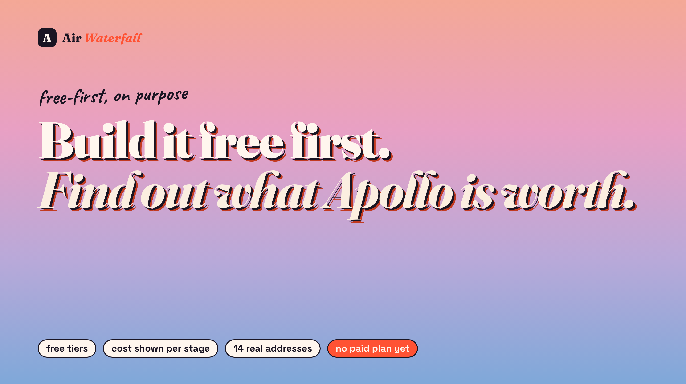

Every outbound team hits the same question: **should we pay for Apollo, Hunter, or something like them?**

Most people answer it from a demo and a pricing page. I tried something different. I built the cheapest working version of an enrichment tool first, on free tiers, and made it log what every step cost and which step actually settled each lookup. Then I let it tell me where it hurt.

Here's my thesis, and the rest of this post is the evidence for it:

> **Don't pay for enrichment data until your stack can tell you which stage earned its credits.**

A free build isn't a compromise. It's the cheapest due diligence you can do on a paid data stack.

I haven't bought a paid plan yet. I'll say that once, plainly, and then I'll be specific about what I expect it to change and how I'll know if I'm wrong.

## The rule: no paid plan until free shows me where it hurts

The tool does two jobs. **Find people:** type a company domain, optionally job titles, and get a list of people. **Enrich them:** click one, and a waterfall of checks returns an email, a confidence score, the evidence, and what every stage cost.

It runs entirely in the cloud on free tiers: a free host, a free hosted Postgres, about 100 free credits a month from a people-data API (People Data Labs), public search results, the company's own website, and metered mailbox checks from a hosted verifier. Nothing runs on my laptop.

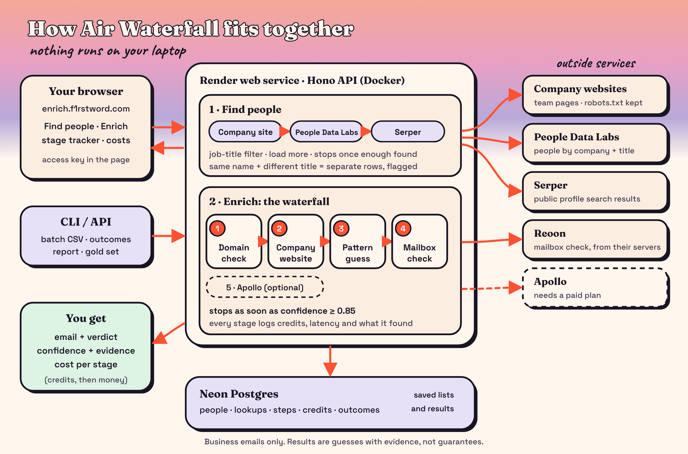

## The one feature that makes a free build worth doing

Plenty of tools return an email. What made this one useful for the "should I pay?" question is a single design choice: **every lookup shows the stage that settled it and what each stage cost.**

The waterfall runs four stages in order of price: a domain check, the company website, a pattern guess, and a mailbox check. After each stage it recomputes confidence, and it stops the moment it's high enough. When you click Enrich, the stages light up one at a time, and the result ends with a line like "Settled at: Mailbox check. Domain check 1 credit, Mailbox check 1 credit. Total 2 credits."

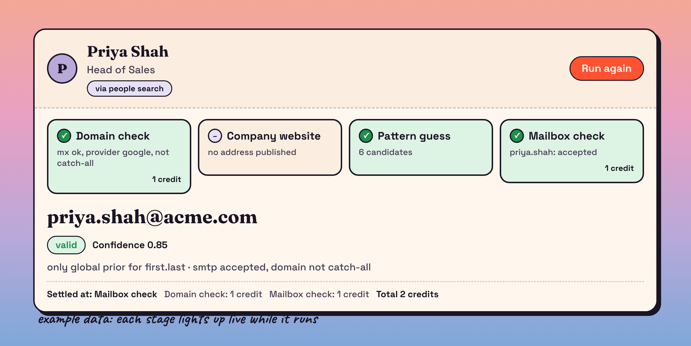

That cost line is the due diligence. If a stage never settles anything, you've learned it isn't worth paying for. If one stage settles most lookups, you've learned where to spend.

## What free got me, said out loud

On my own list of 14 real addresses (13 that work, 1 that bounced):

- The exact address matched for **7 of 14**.
- It gave **2 "valid"** verdicts, and **both were right**. Zero false "valid".
- It never returned the address I knew had bounced.
- It cost **2 to 7 credits** per person, depending on the domain.

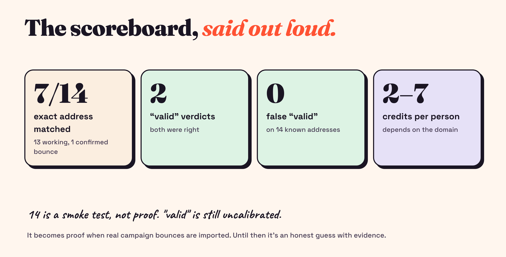

Fourteen addresses is a smoke test, not proof, and "valid" is still uncalibrated until I import real bounces. But it's enough to learn from. Here's what it taught me.

## Where free hurt

- **The host sleeps.** The first click after a quiet spell waits about a minute.
- **The people list is a thin, noisy sample.** About 100 free credits is roughly ten searches of ten people. The data is rough: wrong-company hits, odd titles, and a job-title filter I had to build out of wildcards.
- **Apollo's free plan blocks its own API.** The error was clear: my team "is not permitted to call this endpoint", and all paid plans include full API access. Hunter I scoped out early and never tested.
- **Verification has a ceiling.** Some answers stay "risky" however many credits you spend on probes.

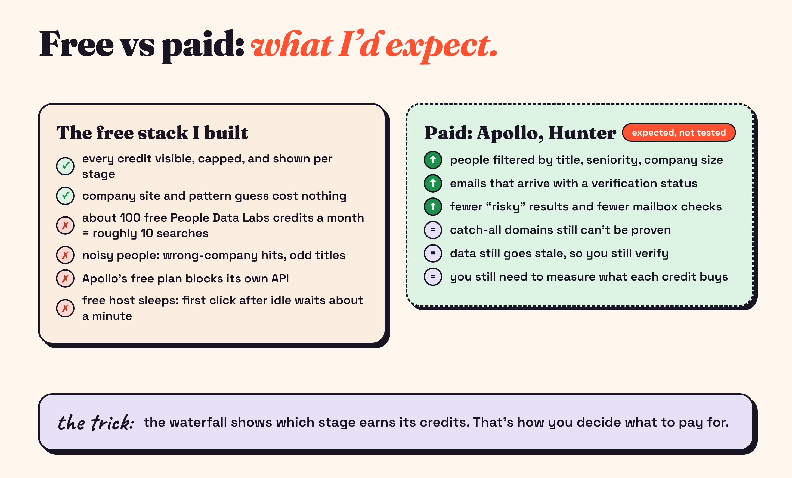

## Four problems that looked like reasons to pay. Only one really was.

This is the part I most want you to take away. The free build produced four problems that *looked* like reasons to upgrade. Only one of them was.

**1. My test data was wrong, not the tool.**
I was grading my tool against addresses I *knew* worked. It marked two as "valid", and by my list both were wrong. The tool said `jane.doe@acme.com`; my list said `janedoe@acme.com`. I almost went hunting for a better data source. Instead I opened the original thread: the address had a dot. The search view I'd exported my list from strips dots out of addresses. The tool was right.

Had I trusted that first score, I'd have paid to fix a bug I didn't have.

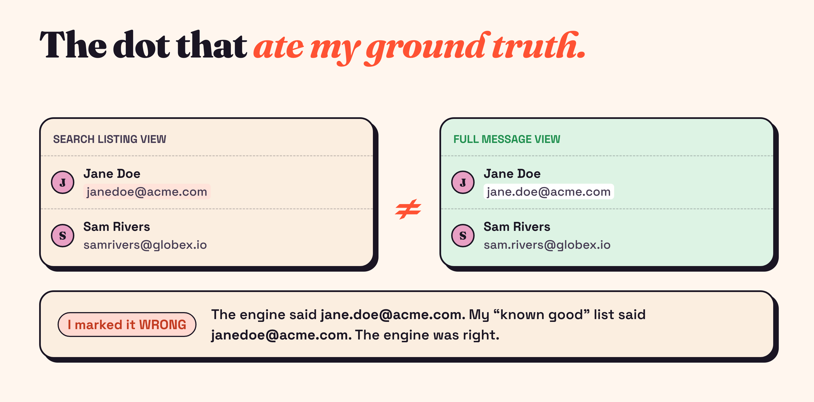

**2. Microsoft 365 says "no" to mailboxes that exist.**
A real person who had emailed me from a Microsoft-hosted company was marked as not existing. Paid data wouldn't fix that; it's a verification quirk. What it did cost me was credits: one lookup burned **7 credits** for a "risky" result because every guess got probed. Treating a "no" there as a penalty, not proof, and capping Microsoft-hosted domains at three probes brought the worst case down to about four.

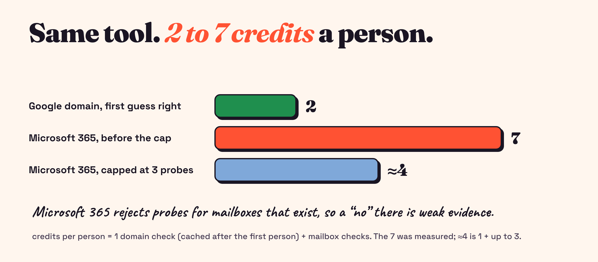

**3. Catch-all domains can't be proven by anyone.**
Some domains accept mail for any address, real or not. On those, no mailbox check proves anything, and no paid plan changes that. So "valid" has to be earned: a catch-all can't score above 0.55, and a guess nothing independent confirmed can't go above 0.84. I'd rather get "risky, and here's why" than a green tick I can't trust.

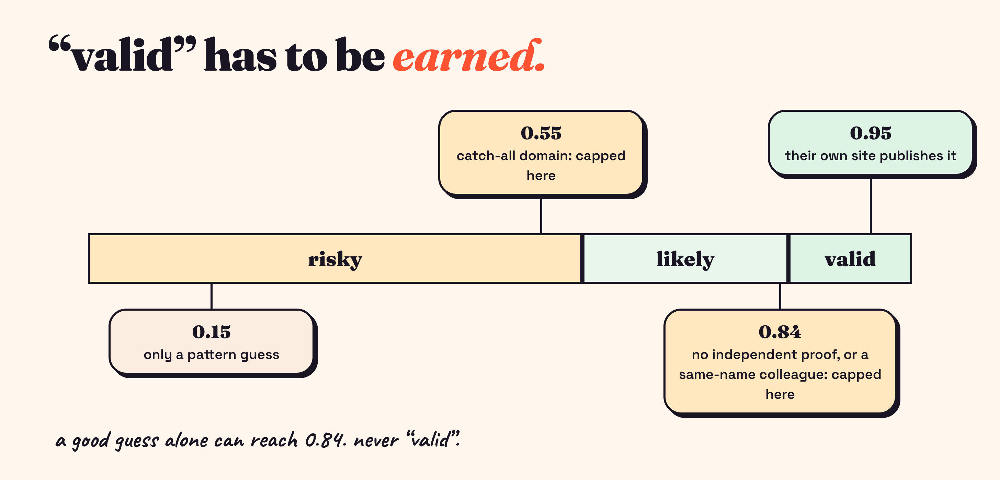

**4. The people data was noisy, and paid probably would fix that.**
My team-page scraper once "found" seven staff on a homepage. Every one was a customer testimonial ("Training Manager at Danone"). A search for a company with a common name returned people from three unrelated companies. I fixed both with rules, but this is exactly the kind of problem better-filtered paid data should shrink.

Put them side by side and you get a table I wish I'd had before opening my wallet:

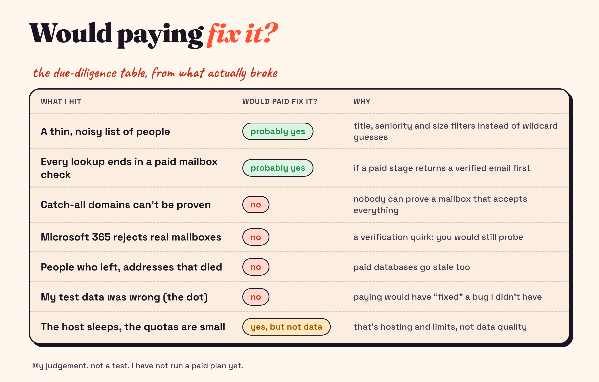

Of the seven things that actually broke, two a paid plan would plausibly help, one is just hosting and limits, and four it wouldn't touch.

## Where paid would slot in

A paid source isn't a rewrite. It's **one more tile** in the waterfall. Apollo's people search takes title, seniority, company-size and location filters, which could replace three noisy free sources for finding people. And an Apollo or Hunter email, which typically arrives with a verification signal, would sit *before* my mailbox check so that some lookups end earlier and cheaper. The Apollo email-lookup adapter already exists in the code (it's blocked by the plan, not by the design), and a people-search source would be a small addition.

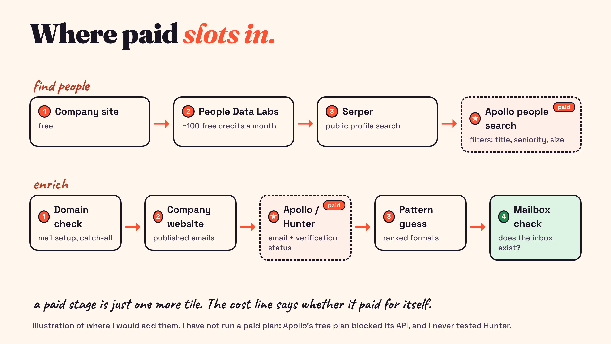

## My prediction, and the rule I'll judge it by

Here's the part that makes this falsifiable. I'm writing the decision rule down *before* I spend anything:

- If a paid stage settles **more than a third** of lookups for about one credit each, **buy it**.
- If it settles **15 to 33%**, it depends on the price per credit and what it replaces.
- If it settles **under 15%**, or mostly repeats what the free stages already found, **skip it**.

My guess is that a paid email stage clears the first bar, mainly because it could end lookups before any mailbox check. I could be wrong, and the numbers will say so. These thresholds are my own rule of thumb, not an industry standard.

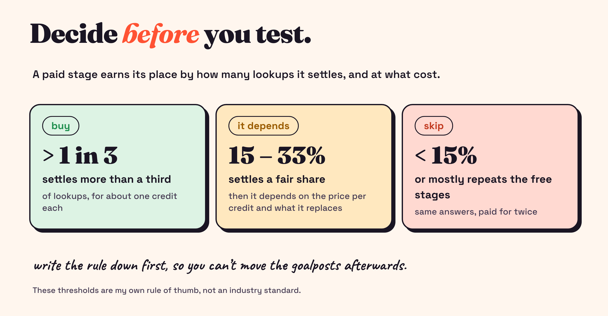

Next, I want to run this exact test on one month of a paid plan and publish the stage-by-stage numbers.

## The method, if you want to copy it

1. **Build the cheapest working version first**, even if it's ugly.
2. **Log credits and the settling stage for every lookup.** This is the whole trick.
3. **Keep a small known-good set, and write down where each answer came from.** Mine came from a view that quietly dropped a character.
4. **Let the tool say "I don't know."** "Risky, because this is a catch-all" is worth more than a hit rate that looks great.
5. **Price each paid stage against the stage it would replace.** Write your buy-or-skip rule before you test.

*I built this pairing with Claude Code: the engine, a test suite (65 tests), the hosted app, and CI. I tested it against real addresses and my own mistakes, not just happy-path examples.*

**Which stage in your own stack would you pay to skip?** Tell me on [LinkedIn](https://www.linkedin.com/in/rudra-trivedi-t04/) or at [rudra@f1rstword.com](mailto:rudra@f1rstword.com). The next post is the paid test, with real numbers.
